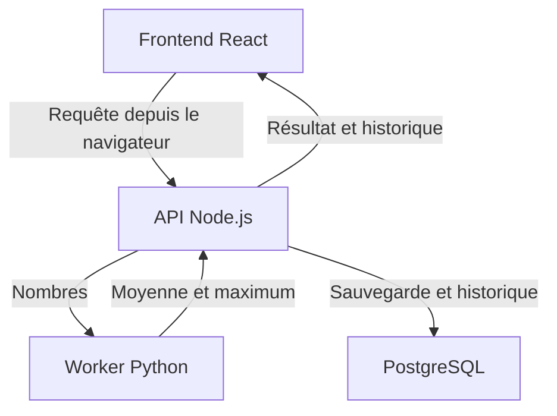

# EcoTrack Analytics

Une organisation souhaite analyser des séries de mesures et conserver les résultats. Depuis une page React, l’utilisateur lance un calcul. L’API Node.js demande au service Python de calculer la moyenne et le maximum, puis enregistre le résultat dans PostgreSQL. La page affiche le résultat et l’historique.



Le JavaScript React s’exécute dans le navigateur. Le conteneur frontend sert les fichiers de la page. Le navigateur appelle localhost:5000 ; dans Docker, l’API contacte worker et db par leur nom de service.

## Votre mission

### 1. Identifier les services

| Dossier ou service | Technologie | Commande de lancement | Port |
|---|---|---|---|
| frontend | React et serveur Node.js | npm run build puis npm start | 3000 |
| api | Node.js Express | npm start | 5000 |
| worker | Python Flask | python app.py | 8000 |
| db | Image postgres:15-alpine | À configurer dans Compose | 5432 interne |


### 2. Tester Python avec un venv

Windows PowerShell :

```powershell
py -m venv .venv
.\.venv\Scripts\Activate.ps1
```

Linux ou macOS :

```bash
python3 -m venv .venv
source .venv/bin/activate
```

Puis :

```bash
python -m pip install -r requirements.txt
python -c "import sys; print(sys.executable)"
python app.py
```

Le chemin Python doit contenir .venv. Ouvrir http://localhost:8000/health : résultat attendu {"status":"ok"}.


### 3. Créer les images

Chaque service applicatif a son propre `Dockerfile` et son `.dockerignore` :

| Image | Fichier | Choix principaux |
|---|---|---|
| ecotrack-worker:1.0 | worker/Dockerfile | `python:3.12-slim`, `pip install -r requirements.txt` copié avant le code (cache des couches), utilisateur non root `appuser`, HEALTHCHECK sur `/health` |
| ecotrack-api:1.0 | api/Dockerfile | `node:20-alpine`, `npm ci --omit=dev` à partir du `package-lock.json`, utilisateur `node`, HEALTHCHECK sur `/health` |
| ecotrack-frontend:1.0 | frontend/Dockerfile | Build multi-étapes : étape 1 `npm ci` + `npm run build` (esbuild génère `public/app.js`), étape 2 ne garde que `server.js` et `public/` → image finale sans esbuild ni sources |

Les `.dockerignore` excluent `node_modules/`, `.venv/`, `__pycache__/`, `.env` et `public/app.js` pour que le contexte de build reste léger et qu'aucun fichier local ne soit copié dans l'image.

### 4. Configurer Compose

Le fichier `compose.yaml` à la racine décrit les 4 services :

- **frontend** : port publié `3000:3000`, réseau `front_net`, démarre quand l'API est *healthy*.
- **api** : port publié `5000:5000` (appelé par le navigateur), réseaux `front_net` **et** `back_net`, variables `POSTGRES_*` et `WORKER_URL=http://worker:8000`, démarre quand `db` et `worker` sont *healthy*.
- **worker** : aucun port publié (`expose: 8000` seulement), réseau `back_net` uniquement.
- **db** : `postgres:15-alpine`, aucun port publié, réseau `back_net`, volume nommé `db_data` sur `/var/lib/postgresql/data`, healthcheck `pg_isready`.

Réseaux :

- `front_net` : réseau bridge normal, utilisé pour publier frontend et api vers l'hôte.
- `back_net` : `internal: true` → ni le worker ni la base ne sont joignables depuis l'hôte ou Internet ; seule l'API (présente sur les deux réseaux) leur parle, par leur nom de service (`worker`, `db`).

### 5. Ajouter le secret

Le mot de passe PostgreSQL n'est jamais écrit dans `compose.yaml` ni dans une variable d'environnement. Il est stocké dans `db_password.txt` (ignoré par Git) et déclaré comme secret Compose :

```yaml
secrets:
  db_password:
    file: ./db_password.txt
```

Il est monté en lecture dans `/run/secrets/db_password` pour `db` et `api`, qui le lisent via `POSTGRES_PASSWORD_FILE`.

**Recréer le secret après un clonage** (à la racine du dépôt) :

Windows PowerShell :

```powershell
Set-Content -Path db_password.txt -Value ([guid]::NewGuid().ToString('N')) -NoNewline -Encoding ascii
```

Linux ou macOS :

```bash
openssl rand -hex 24 | tr -d '\n' > db_password.txt
```

> ⚠️ Sous PowerShell, ne pas utiliser `echo ... > db_password.txt` : le fichier serait encodé en UTF‑16 et le mot de passe serait faux.
> Le mot de passe est fixé à la **première** création du volume `db_data`. Si on change `db_password.txt` ensuite, il faut supprimer le volume : `docker compose down -v`.

### 6. Lancer et vérifier

À la racine, après création des fichiers Docker :

```bash
docker compose config -q
docker compose up -d --build
docker compose ps -a
```

Ouvrir http://localhost:3000 pour l’interface et http://localhost:5000/status pour vérifier les trois services backend.


Si nécessaire :

```bash
docker compose logs api
docker compose logs worker
docker compose logs db
docker compose logs frontend
```

### 7. Compléter le dépôt et remettre

Inclure le code fourni, les trois Dockerfiles, les .dockerignore, compose.yaml, requirements.txt, .gitignore et ce README complété.

Ajouter ici :

- Les noms du binôme et le groupe.
- Vos commandes de lancement et d’arrêt.
- Vos preuves : commande ou action, résultat observé et explication.
- Les vérifications du calcul, de la persistance, des réseaux et du secret.

Exclure db_password.txt, .env, .venv et node_modules. Après un nouveau clonage, un lecteur doit pouvoir recréer le secret et démarrer l’application.

Déposer le lien du dépôt GitLab dans le devoir Moodle avant l’échéance annoncée. Donner accès à l’enseignante.

---

## Rendu du binôme

### Binôme

- Bertrand Pradier
- Groupe : B2 — BUT Informatique Graphique, IUT Clermont Auvergne (Le Puy-en-Velay)

### Lancement et arrêt

```bash
# 1. Cloner puis créer le secret (voir partie 5)
git clone <url-du-depot> && cd Ecotrack

# 2. Vérifier puis lancer
docker compose config -q
docker compose up -d --build
docker compose ps -a

# Arrêter (les données sont conservées dans le volume db_data)
docker compose down

# Arrêter ET effacer les données
docker compose down -v
```

### Preuves

| # | Commande ou action | Résultat observé | Explication |
|---|---|---|---|
| 1 | `python -c "import sys; print(sys.executable)"` dans le venv | `...\Ecotrack\worker\.venv\Scripts\python.exe` | Le Python utilisé est bien celui du venv, isolé du système |
| 2 | http://localhost:8000/health (venv) | `{"status":"ok"}` | Le worker Flask fonctionne hors Docker |
| 3 | `docker compose config -q` | Aucune sortie, code retour 0 | Le fichier Compose est valide |
| 4 | `docker compose up -d --build` | 3 images construites, 4 conteneurs démarrés | Build des Dockerfiles + création des réseaux, du volume et du secret |
| 5 | `docker compose ps -a` | `db`, `worker`, `api`, `frontend` en `Up (healthy)` | Les healthchecks passent ; l'ordre de démarrage est respecté grâce à `depends_on: condition: service_healthy` |
| 6 | http://localhost:5000/status | `{"api":"ok","db":"ok","worker":"ok"}` | L'API joint PostgreSQL et le worker par leur nom de service |
| 7 | http://localhost:3000, saisie `10, 20, 30`, clic « Analyser » | `Moyenne : 20 \| Maximum : 30`, la ligne apparaît dans l'historique | Chaîne complète navigateur → API → worker → PostgreSQL |
| 8 | `curl -X POST localhost:5000/analyze -H "Content-Type: application/json" -d '{"numbers":["a"]}'` | HTTP 400 `{"error":"Fournir 1 à 1000 nombres finis..."}` | Les entrées invalides sont refusées avant le calcul |
| 9 | `docker compose logs api` | `EcoTrack API sur le port 5000` | L'API a créé la table `analyses` puis écoute |


### Vérification du calcul

Pour `[10, 20, 30]` : moyenne = (10 + 20 + 30) / 3 = **20**, maximum = **30**. C'est la valeur renvoyée par `POST /analyze` et affichée par la page. Second test : `[4, 8, 15, 16, 23, 42]` → moyenne **18**, maximum **42**.

Vérification directe en base :

```bash
docker compose exec db psql -U etudiant -d appdb -c "SELECT id, numbers, average, maximum FROM analyses ORDER BY id DESC LIMIT 5;"
```

Résultat obtenu :

```text
 id |   numbers    | average | maximum
----+--------------+---------+---------
  8 | [10, 20, 30] |      20 |      30
  7 | [10, 20, 30] |      20 |      30
  6 | [10, 20, 30] |      20 |      30
  5 | [10, 20, 30] |      20 |      30
  4 | [10, 20, 30] |      20 |      30
(5 rows)
```

### Vérification de la persistance

```bash
docker compose down          # supprime les conteneurs, garde le volume
docker volume ls             # ecotrack_db_data est toujours présent
docker compose up -d
```

Résultat : http://localhost:5000/history renvoie toujours les analyses précédentes. Les données sont dans le volume nommé `db_data`, pas dans le conteneur. Après `docker compose down -v`, l'historique est vide : le volume a été supprimé.

Résultat obtenu :

```text
PS> docker volume ls
DRIVER    VOLUME NAME
local     ecotrack_db_data
```

Après `docker compose down` puis `docker compose up -d`, l'historique sur http://localhost:3000 contient toujours les analyses précédentes : les données survivent à la suppression des conteneurs.

### Vérification des réseaux

```bash
docker network ls                                   # ecotrack_front_net et ecotrack_back_net
docker network inspect ecotrack_back_net            # "Internal": true ; conteneurs api, worker, db
docker network inspect ecotrack_front_net           # conteneurs frontend, api
docker compose ps                                   # seuls 3000 et 5000 sont publiés
```

- http://localhost:8000/health depuis l'hôte **échoue** : le worker n'a pas de port publié.
- `docker compose exec frontend wget -qO- http://worker:8000/health` **échoue** (`bad address 'worker:8000'`) : le frontend n'est pas sur `back_net`.
- `docker compose exec api wget -qO- http://worker:8000/health` renvoie `{"status":"ok"}` : l'API est sur les deux réseaux et résout `worker` par le DNS de Docker.

Résultat obtenu (extrait de `docker network inspect ecotrack_back_net`) :

```text
"Name": "ecotrack_back_net",
"Internal": true,
"Containers": {
    "Name": "ecotrack-worker-1",  "IPv4Address": "172.22.0.2/16"
    "Name": "ecotrack-api-1",     "IPv4Address": "172.22.0.3/16"
    "Name": "ecotrack-db-1",      "IPv4Address": "172.22.0.4/16"
}
```

`"Internal": true` confirme que `back_net` est isolé de l'hôte et d'Internet. Seuls `api`, `worker` et `db` y sont branchés : le frontend n'y a pas accès.

Test de communication entre conteneurs :

```text
PS> docker compose exec api wget -qO- http://worker:8000/health
{"status":"ok"}

PS> docker compose exec frontend wget -qO- http://worker:8000/health
wget: bad address 'worker:8000'
```

L'API (sur `front_net` et `back_net`) joint le worker par son nom de service. Le frontend (seulement sur `front_net`) ne peut même pas résoudre le nom `worker` : les réseaux isolent bien les services.

### Vérification du secret

```bash
docker compose exec api ls -l /run/secrets/       # db_password présent dans le conteneur
docker compose exec api env | findstr POSTGRES     # POSTGRES_PASSWORD_FILE=/run/secrets/db_password, aucun mot de passe en clair
docker inspect ecotrack-db-1 --format "{{json .Config.Env}}"   # pas de POSTGRES_PASSWORD en clair
git status --ignored                               # db_password.txt apparaît dans les fichiers ignorés
```

Résultat obtenu :

```text
PS> docker compose exec api ls -l /run/secrets/
total 0
-rwxrwxrwx    1 root     root            32 Nov 26 10:57 db_password

PS> docker compose exec api env | findstr POSTGRES
POSTGRES_PASSWORD_FILE=/run/secrets/db_password
POSTGRES_HOST=db
POSTGRES_PORT=5432
POSTGRES_DB=appdb
POSTGRES_USER=etudiant
```

Le mot de passe n'apparaît ni dans `compose.yaml`, ni dans les variables d'environnement, ni dans les images, ni dans le dépôt Git : seul le chemin `/run/secrets/db_password` est visible.

### Endpoints fournis

| Service | Méthode et chemin | Rôle |
|---|---|---|
| worker | GET /health | Vérifier Python |
| worker | POST /analyze | Recevoir {"numbers":[10,20,30]} et calculer |
| api | GET /health | Vérifier le processus Node.js |
| api | GET /status | Vérifier PostgreSQL et worker |
| api | POST /analyze | Calculer via Python et enregistrer |
| api | GET /history | Lire les 50 derniers résultats |
